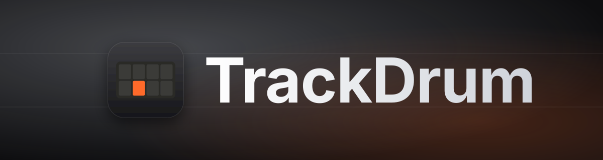
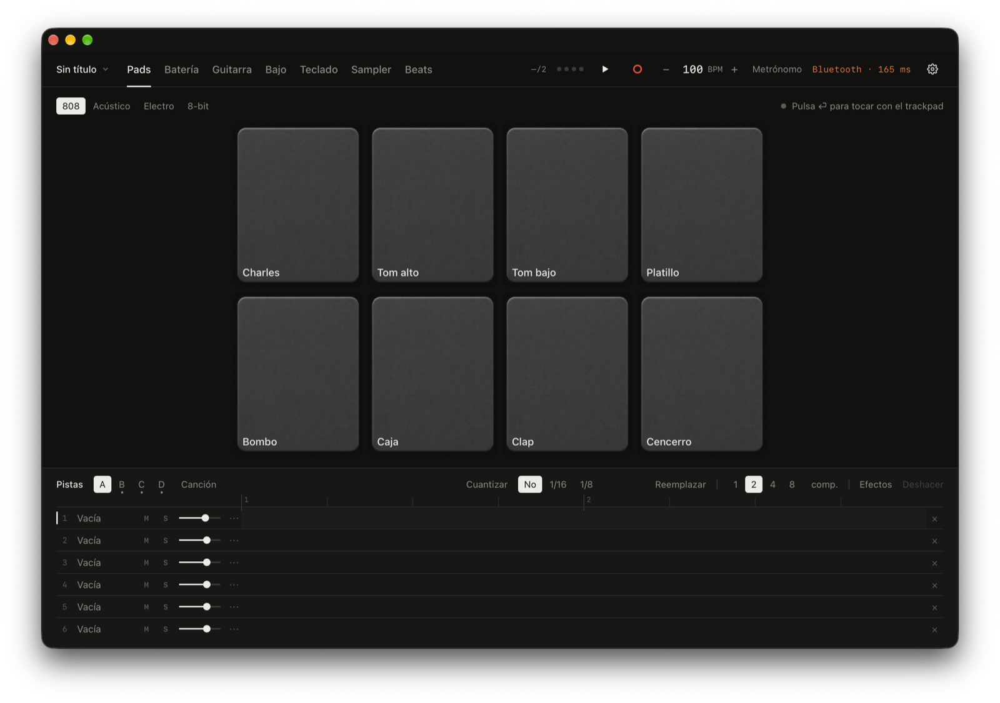
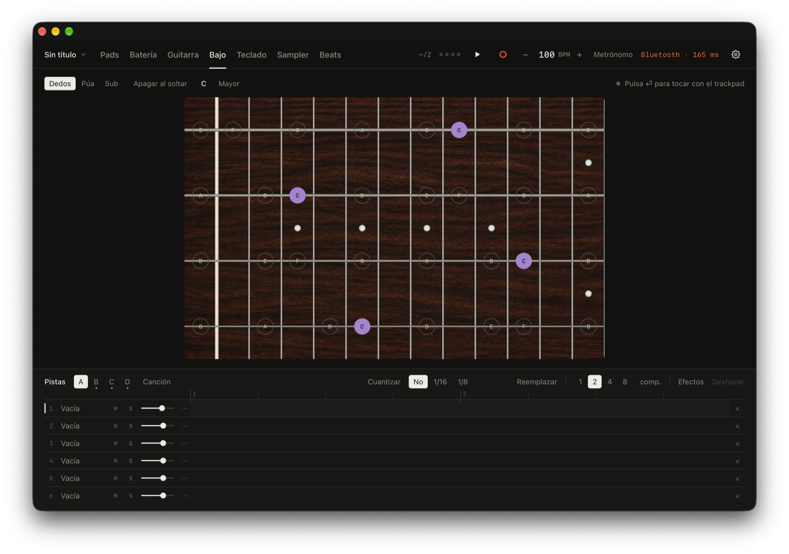
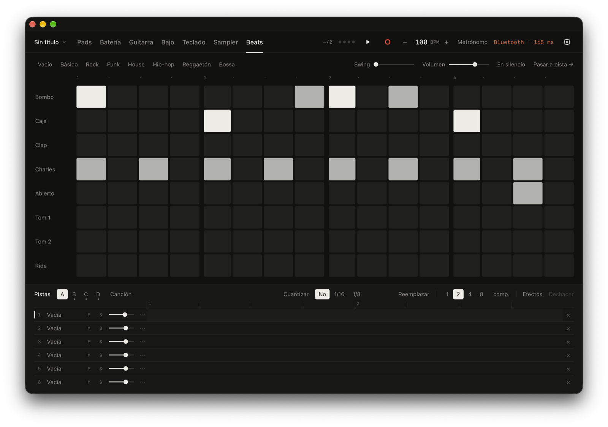
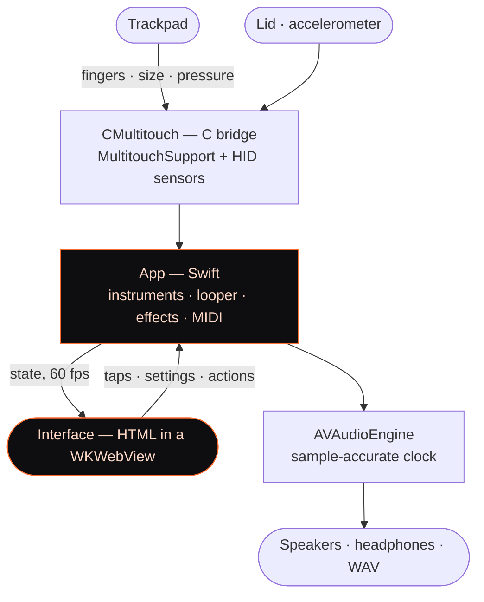

<p align="center">
  
</p>

<p align="center">
  
  
  
  
</p>

Your MacBook's trackpad, turned into an instrument. TrackDrum reads every
finger on the trackpad — where it lands, how hard it hits, how it moves — and
plays drums, guitar, bass, synth or samples with it. Then it loops what you
play into a small multitrack, so you can build a song layer by layer.

It also wakes up the sensors your Mac doesn't tell you about: tilting the lid
works as a hi-hat pedal, and a tap on the palm rest plays the kick.

<p align="center">
  
</p>

## Index

- [Why](#why)
- [Installation](#installation)
- [Usage](#usage)
- [Instruments](#instruments)
- [Keyboard shortcuts](#keyboard-shortcuts)
- [Settings](#settings)
- [Your data](#your-data)
- [How it fits together](#how-it-fits-together)
- [Known limitations](#known-limitations)
- [License](#license)

## Why

The trackpad is the most sensitive input on a MacBook: it tracks ten fingers,
their size and their pressure, hundreds of times a second, and it can tap back
with its haptic engine. Most of the time it just moves a cursor.

TrackDrum uses all of it to make music without plugging anything in:

- **Seven screens, one surface.** Pads, a drum kit, guitar, bass, keys, a
  melodic sampler and a step sequencer — each one maps straight onto the
  trackpad.
- **It feels like hitting something.** Harder hits play louder, and the
  trackpad clicks back on every hit, string or note.
- **A looper, not just a toy.** Six stereo tracks, four scenes you can chain
  into a song, quantize, effects and WAV export.
- **Native, not Electron.** A Swift app with a sample-accurate audio engine;
  the interface is a single HTML file in a WebView.

## Installation

TrackDrum is built from source. You need the Xcode command line tools
(`xcode-select --install`):

```sh
git clone https://github.com/alexcalatyd/TrackDrum.git
cd TrackDrum
./Scripts/build-app.sh
```

That compiles the app, draws its icon, signs it ad hoc and installs it into
`/Applications`. It needs a MacBook with Apple Silicon and a Force Touch
trackpad, on macOS 13 or later. Built on your own machine, Gatekeeper doesn't
get in the way.

Pass `--no-install` to leave it in `build/TrackDrum.app` instead.

## Usage

1. Pick a screen at the top (or press **1**–**7**).
2. Press **Return** to play with the trackpad. The cursor locks and the
   trackpad becomes the instrument. **Esc** gives you the mouse back.
3. Press **Space** to start the loop and **R** to record on the selected
   track. Recording starts after a one-bar count-in.

Every take goes onto the selected track and layers over what's already there,
unless **Replace** is on. Switch scenes (A–D) to work on different parts, and
turn on **Song** to chain them.

The interface speaks English and Spanish. It follows your Mac's language, and
**Settings → Language** switches it, menus included.

## Instruments

| | |
|---|---|
|  |  |
| **Pads** — 4×2 pads and four kits (808, Acoustic, Electro, 8-bit). Drop your own sample on any pad. | **Guitar** — real-time plucked strings. Hold a chord on the keyboard (A–Ñ, Z–N) and strum across the trackpad. |
|  |  |
| **Bass** — four strings and twelve frets laid out on the trackpad, with the notes of the key marked. | **Keys** — a polyphonic synth: left to right are the notes, up is brighter, pressing harder adds vibrato. |
|  |  |
| **Sampler** — eight melodic pads in the current key. Load any sound and tune it. | **Beats** — a 16-step sequencer with presets and swing. Send the pattern to a track when you like it. |

The **Drums** screen at the top maps a whole kit onto the trackpad: each piece
is hit where it's drawn. Bass, keys and sampler share one key and scale.

## Keyboard shortcuts

| Shortcut | Action |
|---|---|
| **1** … **7** | Switch screen |
| **↩** | Play with the trackpad |
| **Esc** | Give the mouse back |
| **Space** | Play / stop |
| **R** | Record on the selected track |
| **M** | Metronome |
| **↑** / **↓** | Tempo (hold **⇧** for ±5) |
| **⌘Z** | Undo the last take |
| **⌘N** · **⌘O** · **⌘S** · **⇧⌘S** | New, open, save, save as |
| **⌘E** | Export the mix |

## Settings

Open them from the gear in the top right.

- **Hit strength** — harder hits play louder.
- **Lid = hi-hat pedal** — tilt the screen back to open the hi-hat, bring it
  forward to close it.
- **Tap the chassis = kick** — a light tap on the palm rest plays the kick,
  with its own sensitivity. See below.
- **Metronome** — it can vibrate on the trackpad, sound, or both.
- **Haptics when playing** — on by default.
- **MIDI output** — shows up as "TrackDrum" in GarageBand, Logic or any DAW.
- **Audio output** — calibrate the delay of wireless headphones, so your
  recordings land on the beat.
- **Language** — Automatic, English or Español.

<details>
<summary><b>Why the kick asks for your password once</b></summary>
<br>

The palm-rest accelerometer only sends data to root. Instead of running the
whole app with `sudo`, TrackDrum installs a tiny helper the first time you
enable it: a LaunchDaemon that's just the app's own binary started with
`--accel-daemon`. It only reads the sensor while TrackDrum is open and asking
for it, and sends the readings over localhost. **Remove helper**, in the same
place, uninstalls it.

</details>

## Your data

Projects are `.trackdrum` folders: a `proyecto.json` plus one WAV per track
and scene. They're saved in `~/Music/TrackDrum` unless you choose otherwise,
and the current session is autosaved every 20 seconds to
`~/Library/Application Support/TrackDrum/`. Exports are plain WAV files.
Nothing is sent anywhere.

## How it fits together



- `Sources/CMultitouch` — the C bridge: the private `MultitouchSupport`
  framework, the haptic engine (`MTActuatorActuate`) and the hidden HID
  sensors (lid angle: page 0x20 / usage 0x8A; accelerometer: AppleSPU page
  0xFF00 / usage 3).
- `Sources/TrackDrum` — the app: `AudioEngine.swift` (tracks, scenes, song,
  recording and export), `Guitar.swift`, `Synth.swift`, `Kits.swift` and
  `DSP.swift` (every sound is synthesized), `Effects.swift`, `Midi.swift`,
  `Project.swift`, `AccelHelper.swift` and `main.swift`.
- `Sources/TrackDrum/Web/index.html` — the whole interface.
- `Scripts/build-app.sh` — builds and installs `TrackDrum.app`;
  `Scripts/make-icon.swift` draws the icon.

<details>
<summary><b>How the interface talks to the app</b></summary>
<br>

Sixty times a second the app calls `TD.frame(state, flashes, fingers)` in the
web view with everything the screen needs. The interface answers with small
messages — `play`, `rec`, `mode`, `hit`, `step`… — through
`window.webkit.messageHandlers.td`. Audio never goes through the web view.

</details>

<details>
<summary><b>Checking the sounds</b></summary>
<br>

```sh
swift build -c release
.build/release/TrackDrum --selftest
```

It renders every kit, instrument and effect, plays a two-scene song, saves and
reopens a project, and fails if anything comes out silent, clipped or broken.
`./run.sh` builds and runs the app from the terminal, with its logs.

</details>

## Known limitations

- **Apple Silicon MacBooks only**, macOS 13 or later, and for now built from
  source.
- It relies on private macOS frameworks, so it can't go on the App Store and a
  future macOS update could break it.
- The tap-to-kick needs the helper and your administrator password once.
- With Bluetooth headphones there's always some delay; calibrate it in
  Settings so recordings line up.

## License

MIT — see [LICENSE](LICENSE).
