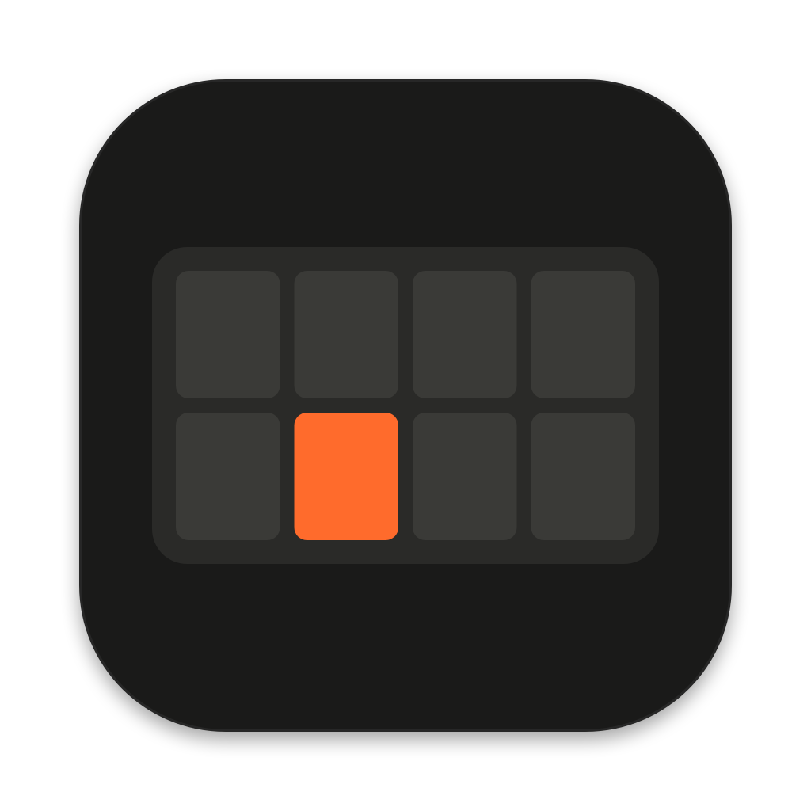
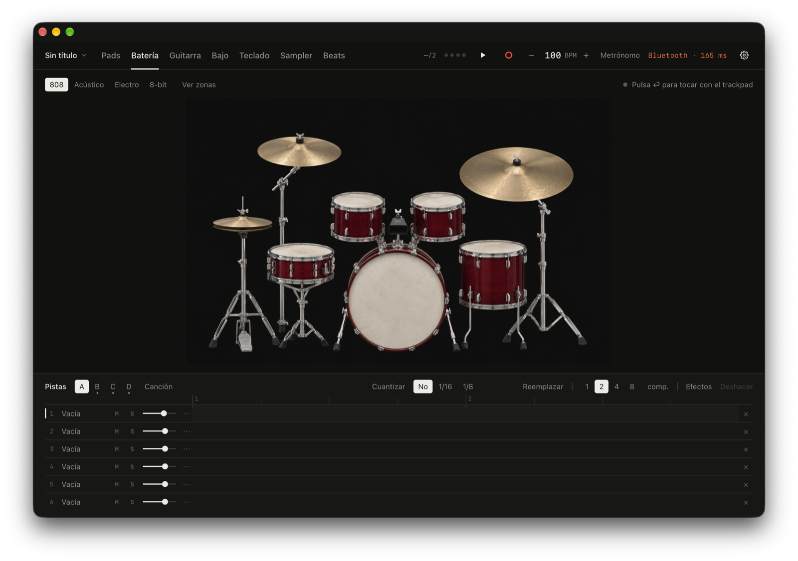
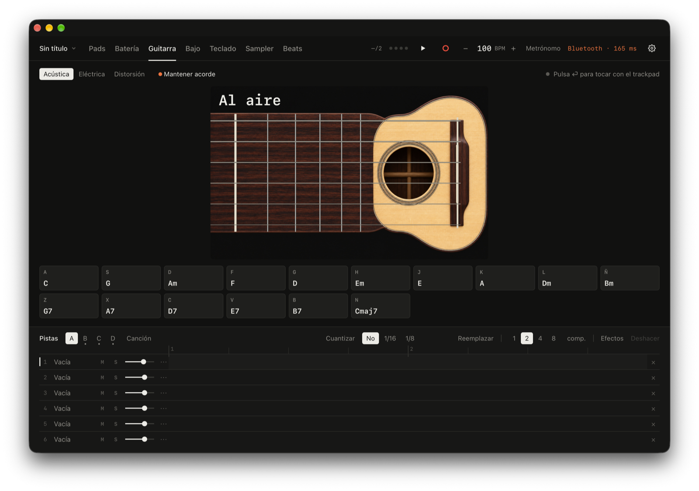
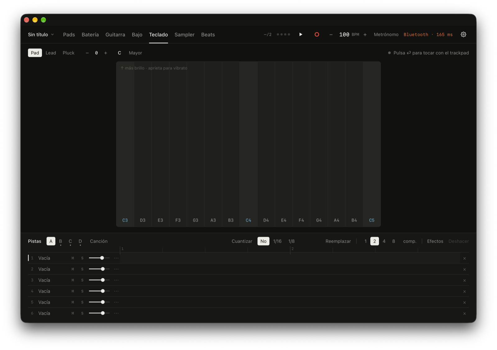
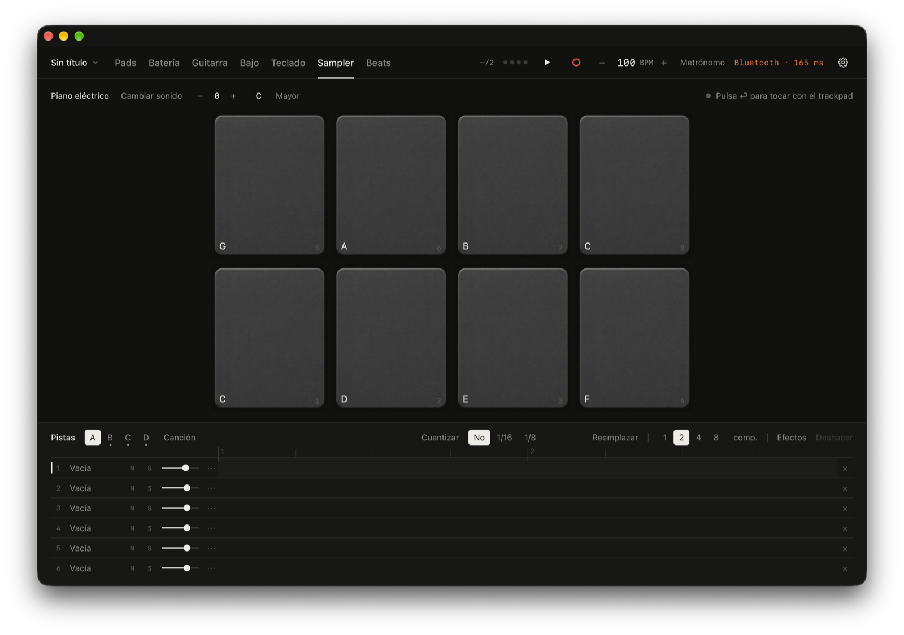

<p align="center"></p>

<h1 align="center">TrackDrum</h1>

<p align="center">Turn your MacBook's trackpad into an instrument — and loop what you play.</p>

<p align="center"></p>

TrackDrum is a native macOS app (Swift + a WKWebView interface) that reads raw multitouch data from the trackpad, so every finger, position and pressure becomes a note. It also uses the MacBook's hidden sensors: the lid angle works as a hi-hat pedal and a tap on the palm rest plays the kick.

*La app está en inglés y en español: sigue el idioma del Mac y se puede cambiar en Ajustes.*

## Instruments

- **Pads** — 4×2 drum pads with four kits (808, Acoustic, Electro, 8-bit). Drop your own samples on any pad.
- **Drums** — a full kit mapped 1:1 onto the trackpad.
- **Guitar** — real-time Karplus-Strong strings. Pick chords with the keyboard (A–Ñ, Z–N) and strum by swiping across the trackpad.
- **Bass** — four strings and 12 frets laid out on the trackpad, with the notes of the current scale marked.
- **Keys** — polyphonic synth: horizontal = notes, vertical = brightness, pressure = vibrato.
- **Sampler** — eight melodic pads that follow the key; load any sound and tune it.
- **Beats** — 16-step sequencer with presets, swing and "send to track".

## Screenshots

| | |
| --- | --- |
|  |  |
| **Pads** | **Guitar** |
|  |  |
| **Bass** | **Keys** |
|  |  |
| **Sampler** | **Beats** |

<sub>Screenshots show the Spanish interface; the app follows your Mac's language.</sub>

## Looper

Six stereo tracks with volume, pan, mute/solo and reverb/delay sends, four scenes (A–D) that can be chained into a song, quantize, replace/overdub, undo, master compressor, and WAV export (full mix or separate tracks). Projects are saved as `.trackdrum` folders and autosaved.

There's also latency calibration for Bluetooth headphones, haptic feedback on the trackpad and a virtual MIDI output to drive GarageBand, Logic or any DAW.

## Requirements

- A MacBook with Apple Silicon and a Force Touch trackpad
- macOS 13 or later
- Xcode command line tools (`xcode-select --install`)

## Install

```sh
git clone https://github.com/alexcalatyd/TrackDrum.git
cd TrackDrum
./Scripts/build-app.sh
```

This builds `TrackDrum.app`, signs it locally and copies it to `/Applications`. Use `--no-install` to leave it in `build/`.

For development, `./run.sh` builds and runs it from the terminal so you can see the logs.

### Tap-to-kick (optional)

The palm-rest accelerometer only sends data to root. Instead of running the whole app with `sudo`, TrackDrum installs a tiny helper (a LaunchDaemon) the first time you enable it in **Settings → Tap the chassis = kick**. It asks for your password once and only streams accelerometer readings to the app over localhost while TrackDrum is open. You can remove it from the same place.

## Keyboard shortcuts

| Key | Action |
| --- | --- |
| `1`–`7` | Switch screen |
| `Return` | Play with the trackpad (locks the cursor) · `Esc` releases it |
| `Space` | Play / stop |
| `R` | Record on the selected track |
| `M` | Metronome |
| `↑` / `↓` | Tempo (hold `Shift` for ±5) |
| `⌘Z` | Undo last take |
| `⌘N` `⌘O` `⌘S` `⇧⌘S` `⌘E` | New, open, save, save as, export |

## How it works

- `Sources/CMultitouch` — C bridge to the private `MultitouchSupport` framework, the haptic engine (`MTActuatorActuate`) and the hidden HID sensors (lid angle: page 0x20 / usage 0x8A; accelerometer: AppleSPU page 0xFF00 / usage 3).
- `Sources/TrackDrum` — audio engine (`AVAudioEngine` with a sample-accurate looper), synths, effects, MIDI, projects and the app itself.
- `Sources/TrackDrum/Web/index.html` — the whole interface.
- `.build/release/TrackDrum --selftest` renders every sound, effect and a project round-trip, and checks that they're healthy.

TrackDrum uses private macOS APIs, so it can't be distributed through the App Store.
